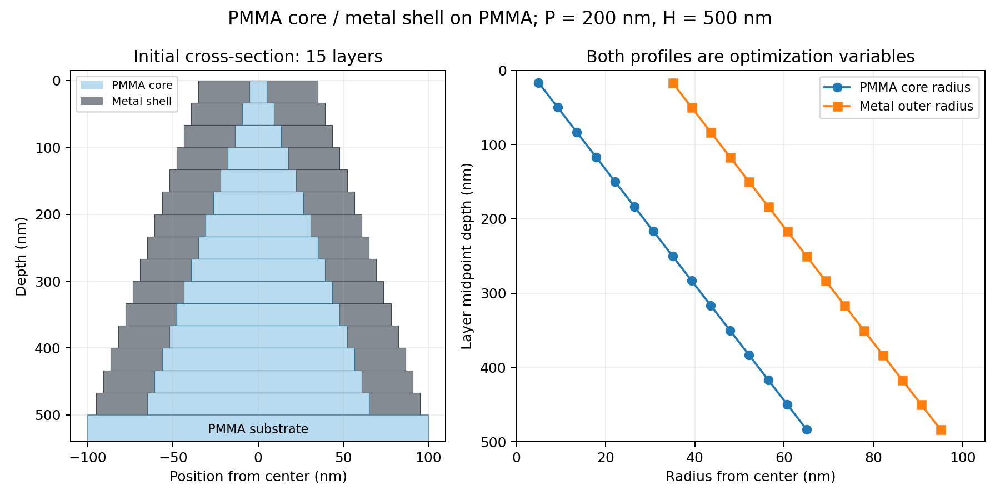

# PMMA芯＋金属被覆：両半径を最適化する独立ケース

対象はAl、Ti、Cu、Au、Agです。PMMA芯を同心円状の金属被覆が囲み、その下に半無限PMMA基板を置きます。各ケースは単独で別PCへコピーして実行できます。

## フォルダ

```text
Optimization/PMMA_metal/
  Al/pmma_al_motheye_P200_H500_Nz15/
  Ti/pmma_ti_motheye_P200_H500_Nz15/
  Cu/pmma_cu_motheye_P200_H500_Nz15/
  Au/pmma_au_motheye_P200_H500_Nz15/
  Ag/pmma_ag_motheye_P200_H500_Nz15/
```

各フォルダ内にrun.py、optimizer、rcwa_ext、金属とPMMAのCSV、設定、確認コードを同梱しています。既存の金属単体やPMMA単体のフォルダは変更しません。

## 形状と目的関数

- 六方格子、周期200 nm、パターン総高さ500 nm、等厚15層（各33.333… nm）。空気から垂直入射、x偏光です。
- 各層にPMMA芯半径r_PMMAと金属外半径r_metalを置き、空気／金属円環／PMMA芯の断面とします。
- 両方の半径をそれぞれ上から下へ単調増加させ、すべての層で0 < r_PMMA < r_metal < 100 nmを保ちます。
- 15個ずつ、計30個の物理的な半径が最適化対象です。上端・下端の半径も固定しません。32個の実数softmax logits（独立な加算ゲージ2個）で表現します。
- 金属の半径差を一定にする拘束や、r_PMMA/r_metal比の単調性は課しません。成膜で得られる一定の法線方向膜厚や層間の金属接続性にも、追加の拘束は課していません。
- 固定の上部金属キャップ、谷部の連続金属膜は追加しません。既存の固定30 nm成膜研究にある追加膜とは、モデルの定義が異なります。



既定の最適化帯域は400–700 nm、10 nm間隔の31波長で、算術平均の吸収率を最大化します。

`A(lambda) = 1 - R(lambda) - T(lambda)`

PMMA芯・基板はk=0のlosslessと仮定するため、TはPMMA基板へ透過する電力です。目的関数はmean(R+T)を最小化し、mean(A)=1-mean(R+T)を最大化します。金属単体の不透明基板で使った1-Rとは定義が異なります。出力のobjective/best_lossはR+Tの平均、mean_absorptance/best_absorptanceはAの平均です。

Aは表面の電力収支から計算します。体積損失積分による独立な吸収検証は含みません。

## 単調性と包含関係のパラメータ化

2組の独立した累積softmaxから、単調増加する潜在半径a,bを作ります。

```text
PMMA半径 = min(a, b)
金属外半径 = max(a, b) + delta
```

min/maxによって両半径の単調増加と包含関係を同時に保ちます。一定膜厚や半径比の拘束は加わりません。min/maxは区分的に微分可能で、同値点ではPyTorchの対称なsubgradientを使います。

delta=min_shell_thickness_nmは既定0.001 nm、radius_min_nmも0.001 nm、radius_max_nmは99.999 nmです。softmax_gap_floor=1e-6により、ごく小さい正の半径増分を保ちます。これらは数値上の下限で、製造上の最小膜厚を意味しません。必要な最小膜厚がある場合はconfigで変更し、新しい出力先を使用してください。

初期値はPMMA半径5→65 nm、金属外半径35→95 nmの線形15層です。初期半径差は30 nmですが、最適化中の膜厚は可変です。

## 分散データ

各材料の既存CSVをそのままコピーしています。

- Al：AlケースのRakic (Al).csv
- Ti：TiケースのTi.csv
- Cu：CuケースのCu.csv
- Au：Auケースのau_measured_nk.csv
- Ag：AgケースのAg.csv
- PMMA：PMMAケースのSzczurowski.csv

各ケースのdata/metal.csv、data/PMMA.csvを使用し、元のパスとSHA256はdata/source_provenance.jsonに記録しています。金属はepsilon=(n+ik)^2を波長に対して線形補間し、表の範囲外へ外挿しません。PMMAはnを線形補間し、k=0を仮定します。PMMAの表が404.7 nmから始まるため、400–404.7 nmは既存と同じ先頭区間による線形延長です。延長した波長をprovenanceと各波長の出力に記録します。

## 最適化方式と終了

Optunaが初期学習率を探索し、各trial内のAdamが両方の半径を更新します。既定config.jsonは30 trials、最大500回の受理更新、patience=100です。確認用config_hex_trial1_M8_Q512.jsonは1 trialに限定します。どちらもM8・grid512です。

非物理な候補更新では、形状とAdamの内部状態を更新前へ戻し、学習率を半減して再試行します。物理チェックは有効なままで、R/T/Aをクリップして採用しません。最小学習率1e-6、最大12回の縮小再試行です。初期形状が不合格の場合は、同じ初期形状を使う残りの学習率探索を繰り返さず停止します。

再試行上限ではbacktracking_exhaustedとして失敗を明示し、通過済みの最良形状をtrial内のbest.jsonとbest_profile.csvに保持します。OOMは別扱いで、RUNNINGのtrialと最後の通過済み状態を保存して中断します。

最適化後は一度停止します。収束確認・監査・スペクトル・図の取得は、別コマンドです。mode allもoptimizeのaliasです。

## 1 trialの実行例（Al）

ZIPを研究ルート `/home/7/uq06557/common2/20260813/tsoyutarcwa` に展開してください。

```bash
( set -e; cd /home/7/uq06557/common2/20260813/tsoyutarcwa/Optimization/PMMA_metal; d="$PWD/Al/pmma_al_motheye_P200_H500_Nz15"; python "$d/run.py" --config "$d/config_hex_trial1_M8_Q512.json" --device cuda:0 --mode optimize --lattices hexagonal --skip-audit --timeout-hours 0 --output-root "$d/results/hex_trial1_M8_Q512_v1"; )
```

他の材料はAl/pmma_alをTi/pmma_ti、Cu/pmma_cu、Au/pmma_au、Ag/pmma_agへ変更します。

5材料を同じPCで順番に実行する場合：

```bash
( set -e; cd /home/7/uq06557/common2/20260813/tsoyutarcwa/Optimization/PMMA_metal; for pair in Al:al Ti:ti Cu:cu Au:au Ag:ag; do material=${pair%:*}; name=${pair#*:}; d="$PWD/$material/pmma_${name}_motheye_P200_H500_Nz15"; printf '\nStarting PMMA + %s\n' "$material"; python "$d/run.py" --config "$d/config_hex_trial1_M8_Q512.json" --device cuda:0 --mode optimize --lattices hexagonal --skip-audit --timeout-hours 0 --output-root "$d/results/hex_trial1_M8_Q512_v1"; done; )
```

この最適化用バッチは中断・失敗時に停止します。各ケースは独立なので、異なるPCでそれぞれのフォルダを実行することもできます。必要なPyTorch CUDA環境は既存のものを使用してください。

## 終了状態・途中再開

ケースフォルダ内で：

```bash
python check_status.py --run-root results/hex_trial1_M8_Q512_v1
```

optimization_completed=true、COMPLETEを確認します。accepted_adam_updatesは受理した更新回数、valid_gradient_evaluationsは初期評価を含む成功した勾配評価数です。historyのstepは受理更新回数に対応し、初期形状はstep0、1回目の受理更新はstep1です。両半径の単調性・包含関係と、best_mean_absorptanceも表示します。

通常の中断やOOM後は、設定・ソース・出力先を変えず同じoptimizeコマンドで再開します。計算途中の候補は再計算されます。古いlockが残った場合は、元の計算・解析プロセスが終了したことを確認してから--recover-lockを追加してください。FAILになったtrialは同じtrials=1の出力先を指定し直しても自動再試行されません。

最適化の途中経過は `results/hex_trial1_M8_Q512_v1/hexagonal/trials/trial_0000/worker/worker.log`、history.csv、backtracking.csvに保存します。出力のpmma_radius_nmとmetal_radius_nmは中心からの半径、metal_shell_thickness_nmは両者の差です。

## 初期形状の検証

全5材料の小規模な値・勾配・Fresnel照合：

```bash
( set -e; cd /home/7/uq06557/common2/20260813/tsoyutarcwa/Optimization/PMMA_metal; python validate_cases.py --device cuda:0 --suite small; )
```

M8・grid512・15層・全31波長の初期形状のforwardと勾配を確認：

```bash
( set -e; cd /home/7/uq06557/common2/20260813/tsoyutarcwa/Optimization/PMMA_metal; python validate_cases.py --device cuda:0 --suite initial --with-gradient; )
```

forwardだけなら--with-gradientを外します。各ケースのvalidate_case.pyを単独実行することもできます。この初期確認は、以後すべての更新や数値収束を保証するものではありません。

## 収束確認（Alの例）

```bash
( set -e; cd /home/7/uq06557/common2/20260813/tsoyutarcwa/Optimization/PMMA_metal; d="$PWD/Al/pmma_al_motheye_P200_H500_Nz15"; python "$d/run.py" --config "$d/config_hex_trial1_M8_Q512.json" --device cuda:0 --mode convergence --lattices hexagonal --orders 8,12,16,20 --grids 512,1024 --wavelengths 400:700:10 --timeout-hours 0 --output-root "$d/results/hex_trial1_M8_Q512_v1"; )
```

R,T,Aの最大絶対差で判定します。通常のconvergenceは途中の失敗で停止します。非物理値・OOMでも次へ進む場合は、このPMMA_metal用の継続スクリプトを使ってください。

```bash
( set -e; cd /home/7/uq06557/common2/20260813/tsoyutarcwa/Optimization/PMMA_metal; python continue_convergence.py --device cuda:0 --materials Al,Ti,Cu,Au,Ag --orders 4:40:2 --grids 512,1024 --wavelengths 400:700:10 --oom-policy stop-material; )
```

非物理値ではその次数の残りgridを省略して次の次数へ進み、OOMではその材料の残りを省略して次の材料へ進みます。条件ごとの別プロセスでGPUメモリを解放します。元の金属単体用の継続スクリプトは変更していません。

比較の参照は計算に成功した最高次数・最大gridの有限結果で、M40/grid1024が必ず参照になるわけではありません。比較軸が不足する場合のnumerical_convergence_passedはnullです。各条件の成否、比較条件、差を確認してください。

## 計算時間（Alの例）

```bash
( set -e; cd /home/7/uq06557/common2/20260813/tsoyutarcwa/Optimization/PMMA_metal; d="$PWD/Al/pmma_al_motheye_P200_H500_Nz15"; python "$d/run.py" --config "$d/config_hex_trial1_M8_Q512.json" --device cuda:0 --mode timing --lattices hexagonal --order 8 --grid 512 --wavelengths 400:700:10 --repeats 3 --timing-backends auto --timeout-hours 0 --output-root "$d/results/hex_trial1_M8_Q512_v1"; )
```

逆伝播込みの時間です。forwardのみなら--forward-onlyを追加します。autoだけの測定ではreferenceとの一致検査を実施せず、parity_passed=nullです。従来のcore-shellとの比較も行う場合は--timing-backends reference,autoに変更してください。

## 最良形状のスペクトル（Alの例）

```bash
( set -e; cd /home/7/uq06557/common2/20260813/tsoyutarcwa/Optimization/PMMA_metal; d="$PWD/Al/pmma_al_motheye_P200_H500_Nz15"; python "$d/run.py" --config "$d/config_hex_trial1_M8_Q512.json" --device cuda:0 --mode spectrum --lattices hexagonal --order 16 --grid 1024 --wavelengths 400:700:3 --timeout-hours 0 --output-root "$d/results/hex_trial1_M8_Q512_v1"; )
```

上のM16/grid1024は指定例です。採用する次数・gridは収束確認から選んでください。CSV、JSON、R/T/Aと芯・被覆の断面を含むPNGを保存します。履歴と形状全体の図を出す場合は、同じ設定・出力先で--mode plotを別途指定します。

全logitsの方向微分と2つのsoftmaxゲージを確認する監査は--mode auditです。監査は自動実行しません。初期形状・最良形状の通常の検証をまとめる場合は--mode verifyを指定できます。

## 実装・検証範囲

単一円用の高速化をそのまま流用せず、2つの円盤の形状係数と芯に基づく法線場を波長間共有し、PMMA・金属のepsilonと逆epsilon、P/Qを波長ごとに更新します。D6の直接ブロック行列構築・E1縮約を使用します。referenceは既存のfull core-shell NVM経路です。

CPUで確認した内容：

- 幾何10件：両半径の単調性、包含、初期形状の再現、極端なlogits、半径比が減少する形状、Jacobianの有限差分。
- 更新制御6件：両プロフィールの更新、Adam状態の復元、途中再開、再試行上限、非有限勾配、例外の伝播。
- 継続処理11件：非物理値とCUDA/CPU OOMの模擬分岐、次材料への継続、キャッシュ再利用、欠けた比較を合格にしないこと。
- 全5材料：小規模な従来core-shellとのR/T/A・全logits勾配一致、両半径のFD、checkpoint ON/OFF、losslessとFresnel対照。
- 全5材料：M8・grid512・15層・31波長の初期forwardが物理チェック通過。Agでは同じ条件の全勾配評価も通過。
- 実際のOptuna試行：Al/PMMA、15層・32 logits、M2/grid48・3波長で2回の受理更新、終了後の停止、収束確認、timing、スペクトル、図、監査、verify、継続処理の再利用。

検証記録はvalidation_reportsに同梱しています。CUDAでの本番500更新までの完走、および最適形状の次数・grid収束は未確認です。CPUの初期・小規模検証を、それらの保証として扱わないでください。
