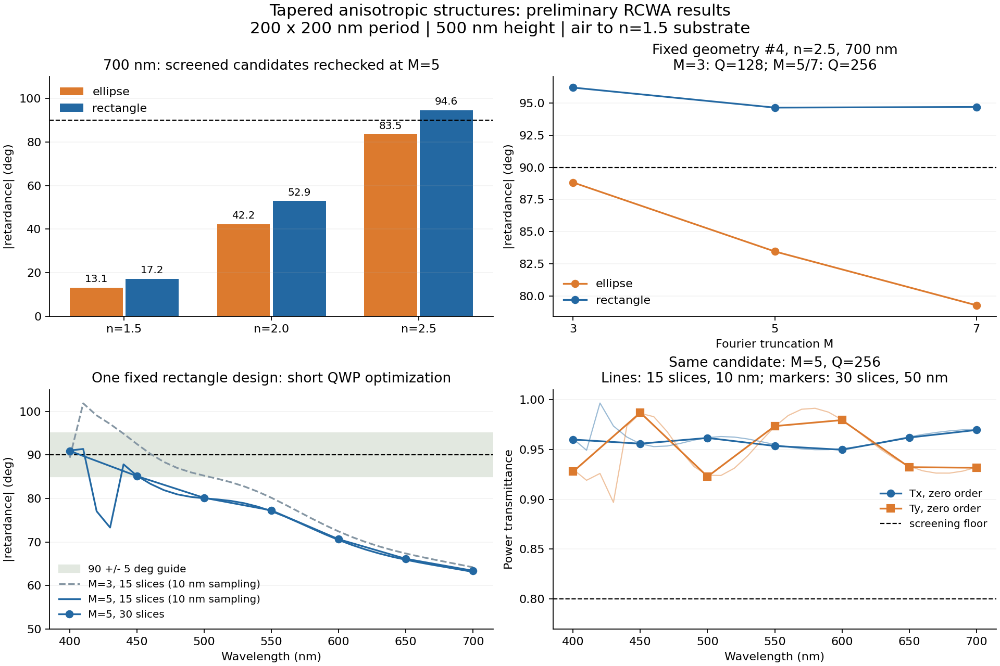

# 初期RCWA計算の結果（2026-10-17）

**最初は正方格子で楕円と長方形を比較し、本格的な最適化はn=2.5の長方形から進めることを推奨する。**
周期を200×200 nm、高さを500 nmに固定し、上から下へ両半幅が増加する形状を実装・計算した。
長方形格子にしなくても、断面の異方性によって位相差が得られる。

## 条件と探索範囲

- 空気から垂直入射。基板は半無限・n=1.5と仮定。
- 構造材料は無損失、波長非依存のn=1.5 / 2.0 / 2.5。
- 楕円の半径、長方形の半幅は各軸5–95 nm。高さ方向は15層の階段近似。
- 最初は各軸3個の節点から単調な形状を作る。各ケース22候補（6初期形状＋16 Sobol候補）。
- 6ケースを400 / 550 / 700 nmで探索。計396回の波長別RCWA評価。
- 初期探索はM=3、ラスタ/ASRグリッドQ=128。両偏光の0次透過率80%以上を評価条件とした。
- 各波長で最大だった候補を固定し、M=5、Q=256で再計算。n=2.5の700 nm候補はM=7でも再計算。

以下は有限候補の探索で見つかった位相差であり、**厳密な最大値ではない**。
高次数での再最適化はまだ行っていない。

## 各波長で見つかった大きな位相差

下表はM=3で選んだ候補をM=5で再計算した結果。位相差はarg(txx×tyy*)の主値の絶対値。
波長ごとに最良の形状が異なる場合があり、一つの形状の広帯域特性を示す表ではない。

| 構造屈折率 | 断面 | 400 nm | 550 nm | 700 nm |
|---|---|---:|---:|---:|
| 1.5 | 楕円 | 23.9° | 16.6° | 13.1° |
| 1.5 | 長方形 | 29.8° | 21.9° | 17.2° |
| 2.0 | 楕円 | 84.0° | 57.4° | 42.2° |
| 2.0 | 長方形 | 105.2° | 67.7° | 52.9° |
| 2.5 | 楕円 | 169.3° | 114.1° | 83.5° |
| 2.5 | 長方形 | 176.4° | 129.9° | 94.6° |

n=2.5の長方形では700 nmでも90°に達し得る候補が見つかった。
したがって、この厚さでの可視広帯域化を検討する出発点として適している。
n=1.5や2.0の不可能性を証明した結果ではないが、今回の探索では長波長側の位相差が不足している。

## 収束確認で分かったこと

同じn=2.5・700 nmの候補（#4）を固定した比較：

| 断面 | M=3、Q=128 | M=5、Q=256 | M=7、Q=256 | M=7のTx00 / Ty00 |
|---|---:|---:|---:|---:|
| 楕円 | 88.82° | 83.45° | 79.27° | 93.64% / 97.17% |
| 長方形 | 96.20° | 94.64° | 94.69° | 88.05% / 96.00% |

楕円はまだ次数を上げた際の変化が大きい。83.5°を確定値や物理上限として扱わない。
長方形はこの波長・形状ではM=5→7で約0.05°の変化だが、これだけで帯域全体の収束を保証しない。
両候補の節点半幅はx=90.5 / 92.3 / 94.1 nm、y=48.2 / 50.0 / 51.8 nm。
これはz=0 / 250 / 500 nmでの寸法で、実際の各層には層中央で補間した値を使用する。

## 同じ形状の広帯域四分の一波長板に向けた試算

n=2.5の長方形について、400 / 450 / 500 / 550 / 600 / 650 / 700 nmの7点で、
90°からの最悪誤差、円偏光度、透過率を評価する差分進化法を短く実行した。
6変数、36評価、2世代という動作確認を兼ねた探索で、最適化の収束には達していない。

得られた形状をM=5、Q=256、30層で再計算すると、7波長点における位相差の絶対値は
約63.4–90.9°、90°からの最大誤差は約26.6°、両偏光の最低0次透過率は約92.3%だった。
この候補は**400–700 nm全域で90°を維持する波長板にはまだなっていない**。
位相差を出せることと、帯域全体で位相差を一定にすることを分けて評価する必要がある。

同じ候補で、M=3→5の変更による位相差の最大変化は約7.29°、Q=128→256では約0.0007°、
15→30層では約0.27°だった（上記7点）。
さらにM=3とM=5で10 nm間隔のスペクトルを計算し、粗い波長点間の変化も確認した。
M=5・15層の10 nm間隔では、位相差は約63.1–91.4°、90°からの最大誤差は約26.9°、
両偏光の最低0次透過率は約89.7%だった。最低透過率は7点評価より低く、波長刻みを細かくする必要性が確認できる。
700 nmをM=7で追加確認した位相差の絶対値は62.90°（15層）。

## 実装・出力

`run.py` のscreen / optimize / verifyで探索・最適化・固定形状の再計算を行う。
`--nodes 15` で形状の自由度を増やし、`--period-x` / `--period-y` で長方形格子も指定できる。
各形状のJSON、層ごとの寸法CSV、透過率・反射率・位相差・円偏光度のCSV、全探索履歴を保存した。
既存の`rcwa_ext`は変更していない。詳しいコマンドは[README_ja.md](README_ja.md)を参照。

物理チェックは8項目すべて合格。Fresnel係数、等軸断面のゼロ位相差、軸交換、エネルギー保存、
交差偏光、高次回折を含む全透過率を確認した。これらはRCWAの数値収束とは別の検証である。
実行環境はPython 3.13.5、PyTorch 2.8.0（CPU）、torcwa 0.1.4.2、complex128。

## 次に進める条件

まず正方格子・長方形断面・n=2.5で、M=5以上を用いて最適化を継続する。
候補の確認ではM、グリッド、z分割、波長刻みをそれぞれ細かくする。
楕円は比較対象として残し、収束の改善が確認できてから本格的な性能比較を行う。
長方形格子は、その後に周期の異方性による改善量を独立して調べる位置づけがよい。

基板を構造と同じnにする場合や、残膜・実材料分散・吸収を含める場合は、これらの数値を流用せず再計算する。
