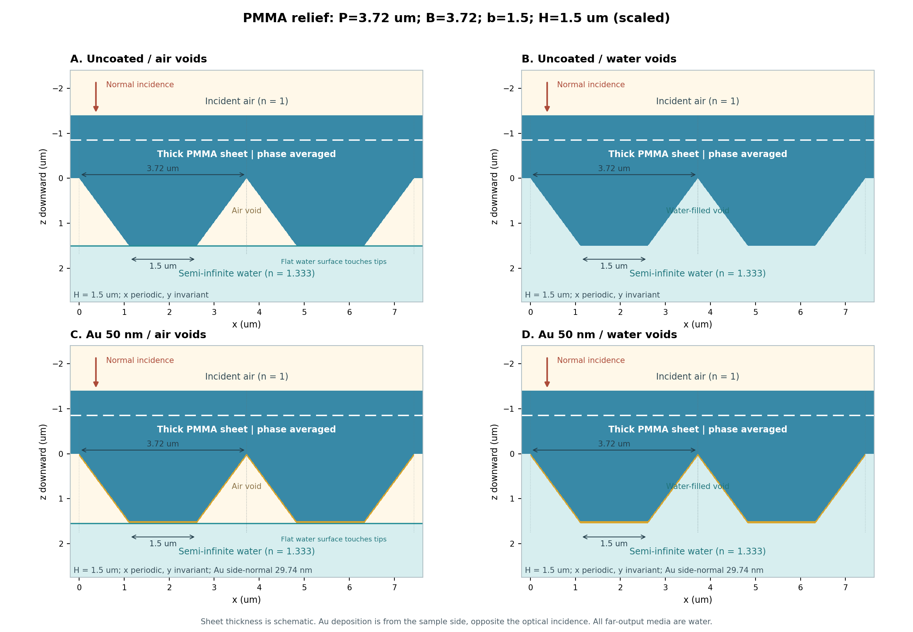
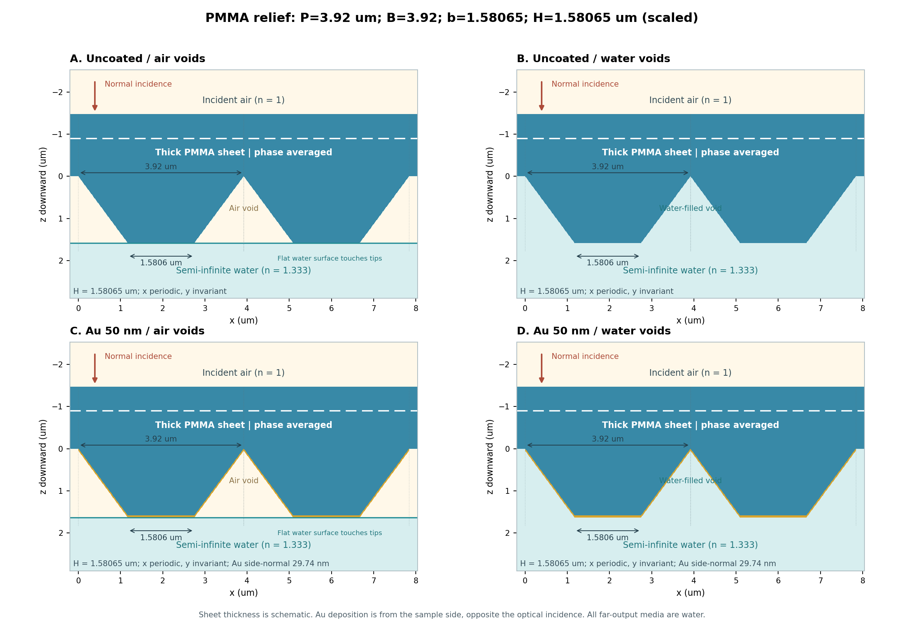

# 厚いPMMAシート下面の1次元逆台形格子 v2

2026-11-13更新。既定で形状の相似拡大・縮小と高速ソルバーを使用します。変更点・一致検証・速度測定は `UPGRADE_ja.md`、導出は `THEORY_ja.md`、検証の生データは `validation/` にあります。

## 形状と光学モデル

周期を Λ と指定すると、PMMAの長辺 B=Λ、短辺 b=Λ×15/37.2、高さ H=Λ×15/37.2 です。**B:b:H=37.2:15:15、根元の隙間 Λ−B=0** を固定します。CLIの寸法単位はnmです。

| 周期・長辺 Λ=B (nm) | 短辺 b (nm) | 高さ H (nm) | 根元の隙間 (nm) |
|---:|---:|---:|---:|
|1860|750|750|0|
|3720|1500|1500|0|
|3920|1580.645161|1580.645161|0|

Auの水平面公称膜厚は**50 nm固定**で、周期とともに拡大しません。試料側から上向きの平行蒸着を、表面高さのz方向50 nmの移動で表します。斜面角53.49856°は相似形状で一定なので、斜面法線膜厚29.74215 nm、片側のx方向膜幅37.000 nmも一定です。

光は上側の空気から垂直入射し、x方向に周期、y方向に一様です。sはEy、pはExを振幅とします。シートも突起もPMMAです。厚いシートの往復位相を平均し、上面のフレネル反射と内部回折光の再入射を含めます。構造内部やAu薄膜の干渉は保持します。

空気溝条件は、溝内が空気で、裸PMMAの先端またはAuの最下面に接する平坦な水面より下が半無限水です。水溝条件は溝も水で満たします。両条件とも最終透過先は水、n=1.333です。水面形状・濡れ・Auの粗さはモデルに含めません。





旧版の周期3920 nmは、長辺3720 nm・短辺/高さ1500 nm・隙間200 nmでした。**新版の周期3920 nmとは別構造**です。旧結果を再現するときだけ `--geometry-mode legacy` を指定します。旧幅・高さの明示指定もlegacy時のみ受け付けます。3720 nmでは旧版と同一形状です。

## 高速化

| 項目 | v2の実装 |
|---|---|
| 波長間の再利用 | 層分割・区間フーリエ係数・偶奇基底を共有。形状・M・層分割・device別のLRUキャッシュ、上限128 MiB |
| 左右対称性 | 局所RCWAも偶対称に縮約。固有値問題を偏光ごとに2M+1からM+1へ縮小 |
| p偏光 | Kxが偶奇を入れ替えるため必要な奇ブロックの逆行列を保持し、Li逆則を維持 |
| 位相平均 | 波長・偏光ごとに基底射影とアドミタンスを一度だけ計算。Sobol点列、バッチ256、打切り基準は旧版と同じ |
| 再実行 | 完成した波長点を共通の永続キャッシュへ保存。スペクトルと収束実行で同一条件を再利用 |
| 出力 | CSV全体の毎回書き直しをやめ、計算点ごとに追記 |

各波長のPMMA/Auの分散、Maxwell演算子、固有値、層間接続は各波長で計算します。異なる波長の固有値やスペクトル値の補間は行いません。これがAl最適化コードにある形状共有と同じ考え方です。波長点を間引く近似は追加していません。

s/p分離・解析的フーリエ係数・逐次Redheffer接続・場保存なし・complex128も継続しています。CUDA指定では局所RCWAがGPU、位相平均はCPUです。垂直入射・左右対称構造に適用する高速化です。

保持次数は引き続き **m=−M,…,+Mの2M+1本** です。例えばM=32では65本を保持し、偶対称部分の固有値問題は33次元です。物理的な±mの出力は別々に保存します。

## 実行

既存RCWAルート（`rcwa_ext/` と `studies/` がある場所）で実行します。既存のCUDA対応Python環境を使用してください。別の場所からは `--solver-root` または `RCWA_ROOT` でルートを指定できます。

```powershell
# 構造図。任意の周期を指定でき、比率は自動適用
python studies/pmma_sheet_relief_1d/run.py --preview-only --periods 1860,3720,3920 --output-dir studies/pmma_sheet_relief_1d/results/v2/preview_scaled

# GPU上で変更前後の一致を検証。60ケース×s/p、時間測定も実施
python studies/pmma_sheet_relief_1d/validate_acceleration.py --device cuda:0 --suite standard --output-dir studies/pmma_sheet_relief_1d/validation/acceleration_cuda_0

# Auなしのスペクトル
python studies/pmma_sheet_relief_1d/uncoated/run_spectrum.py --device cuda:0 --periods 3720,3920 --wavelengths 400:700:5 --order 32 --slices 240

# Au 50 nm。空気溝・水溝とs/pを一括計算
python studies/pmma_sheet_relief_1d/gold/run_spectrum.py --device cuda:0 --periods 3720,3920 --wavelengths 400,550,700 --order 40 --slices 240 --phase-tol 0.00005 --phase-max 262144
```

以下はAuあり・3波長の収束検証コマンドです。高速化・形状比率固定は既定で有効です。最適なM/Nzを保証する値ではなく、収束を検査するための候補列です。

```powershell
# 層数収束：M=48固定、Nz=120→240→480→960
python studies/pmma_sheet_relief_1d/converge.py --coating gold --axis slices --values 120,240,480,960 --device cuda:0 --periods 3720,3920 --wavelengths 400,550,700 --order 48 --phase-tol 0.00005 --phase-max 262144 --tolerance 0.001 --output-dir studies/pmma_sheet_relief_1d/results/v2/scaled/gold/layer_check_M48

# 次数収束：Nz=480固定、M=24→32→40→48→56→64
python studies/pmma_sheet_relief_1d/converge.py --coating gold --axis order --values 24,32,40,48,56,64 --device cuda:0 --periods 3720,3920 --wavelengths 400,550,700 --slices 480 --phase-tol 0.00005 --phase-max 262144 --tolerance 0.001 --output-dir studies/pmma_sheet_relief_1d/results/v2/scaled/gold/order_check_Nz480
```

全次数のR_m/T_m、R/T/A、20°以内/外の反射の最大差を比較し、最後の連続2回が許容値以下なら合格です。位相平均の収束と、その誤差指標が許容値の1/4以下であることも要求します。3波長での合格はその3波長に限ります。未収束時は終了コード2です。層数と次数は独立に検証し、必要なら互いの固定値を増やして再確認してください。

Nzは最大層厚H/Nzを指定します。Auなしの実層数はNz、Auありはz=0,t,H,H+tの境界を正確に置くため増えます。例えばP=3720 nm、Au50 nmではNz120が124層、Nz240が248層です。周期が変わるとHも変わり、Au厚は固定なので実層数も変わり得ます。`actual_layers` に実数を記録します。

切替・診断用の指定：

```powershell
# 元の全偶奇ソルバーと元の位相平均を使い、同じ新版形状を比較
python studies/pmma_sheet_relief_1d/run.py --coating gold --acceleration reference --periods 3920 --wavelengths 550 --output-dir studies/pmma_sheet_relief_1d/results/v2/reference_scaled_3920

# 旧版の隙間200 nmの形状を再現
python studies/pmma_sheet_relief_1d/run.py --coating gold --geometry-mode legacy --periods 3920 --wavelengths 550

# 物理検証と運動学的な回折次数・角度
python studies/pmma_sheet_relief_1d/validate.py
python studies/pmma_sheet_relief_1d/kinematics.py
```

`--acceleration fast|reference`、`--phase-acceleration auto|prepared|reference`、`--geometry-cache on|off` を選べます。既定はfast/auto/onです。CPUを使う場合は `--device cpu`。CUDAを使用できない環境でCUDA指定すると停止し、CPUに自動変更しません。

## 出力とキャッシュ

既定の計算結果は `results/v2/scaled/<coating>/`、収束はその下の `convergence_order/` または `convergence_slices/` です。旧結果を残し、異なる形状・旧バージョンの `settings.json` がある出力先への上書きを拒否します。同じ形状の同じ出力先を再使用した場合は、指定された点だけでCSVを再構成します。

共通点キャッシュは `results/v2/cache/`。`--cache-dir PATH` で変更できます。形状・材料CSV・ソース・波長・M/Nz・位相設定・ソルバー・CPU/CUDA device・torch/numpy版をキーに含めるため、旧形状やCPU結果をGPU検証に流用しません。`completion.json` に `point_cache_hits` と `geometry_plan_cache` を記録します。

| ファイル | 内容 |
|---|---|
|spectra.csv|s/pのR/T/A、0次/回折反射、20°以内/外、実寸法・実層数・数値設定|
|diffraction_orders.csv|mごとのR_m/T_m、反射側空気・透過側水・PMMA内の角度|
|local_single_pass_orders.csv|PMMAからの1回入射に対する局所回折効率|
|settings.json|実形状、材料・ソースのハッシュ、backend、位相設定|
|completion.json|位相平均合否、再利用回数。M/Nz収束は別途検証|
|adjacent_changes.csv / convergence.json|収束比較の最大変化と合否|
|geometry/|Auなし/あり×空気/水のPNG/SVG、層断面CSV|

反射角は上向き法線、透過角は下向き法線から測ります。20°以内の反射合計は0次を含み、上側空気で観測する角度で集計します。各次数の吸収は一意ではないため、吸収は `A_total=1−ΣR_m−ΣT_m` のみを出します。

## 材料と位相モデル

PMMAは同梱のSzczurowski CSVを使用し、k=0、nを線形補間します。400～404.7 nmは、提示式で求めた400 nmのnとCSV先頭値を直線で接続します。CSVが無い場合のみ400～700 nmの全域で提示式へ切り替えます。λをµmとして

\[
n^2-1=\frac{0.99654\lambda^2}{\lambda^2-0.00787}
+\frac{0.18964\lambda^2}{\lambda^2-0.02191}
+\frac{0.00411\lambda^2}{\lambda^2-3.85727}.
\]

Auは同梱のJohnson–Christy CSVのn,kを線形補間し、ε=(n+ik)²とします。範囲外への外挿は行いません。

位相平均は各|m|に独立な一様位相を与え、+mと−mには同じ位相を与えます。厚さばらつき・有限コヒーレンスによる位相消失を仮定するモデルです。厚い完全単色シートの特定膜厚に対する解とは区別します。高速化でもこの仮定と積分点列は維持しています。

## 変更前後の検証結果

CPU、torch 2.8.0+cpuで60ケース・s/p計120条件を比較し合格しました。最大差は、全偶対称振幅6.80×10⁻¹³、各次数のR_m/T_mとR/T合計6.52×10⁻¹⁴、適応位相平均3.80×10⁻¹⁴（絶対パワー比）です。同一条件の比較であり、離散化自体の収束保証とは別です。

Auあり・P3720・空気溝・M24・Nz120の測定では、局所RCWAの3波長合計の中央値が2.115→0.780秒（2.71倍）、位相平均を含む550 nmのs/p計算が0.725→0.289秒（2.51倍）でした。GPUでの一致・時間測定はこの環境では未実施です。上記の `validate_acceleration.py --device cuda:0` で実機検証してください。
