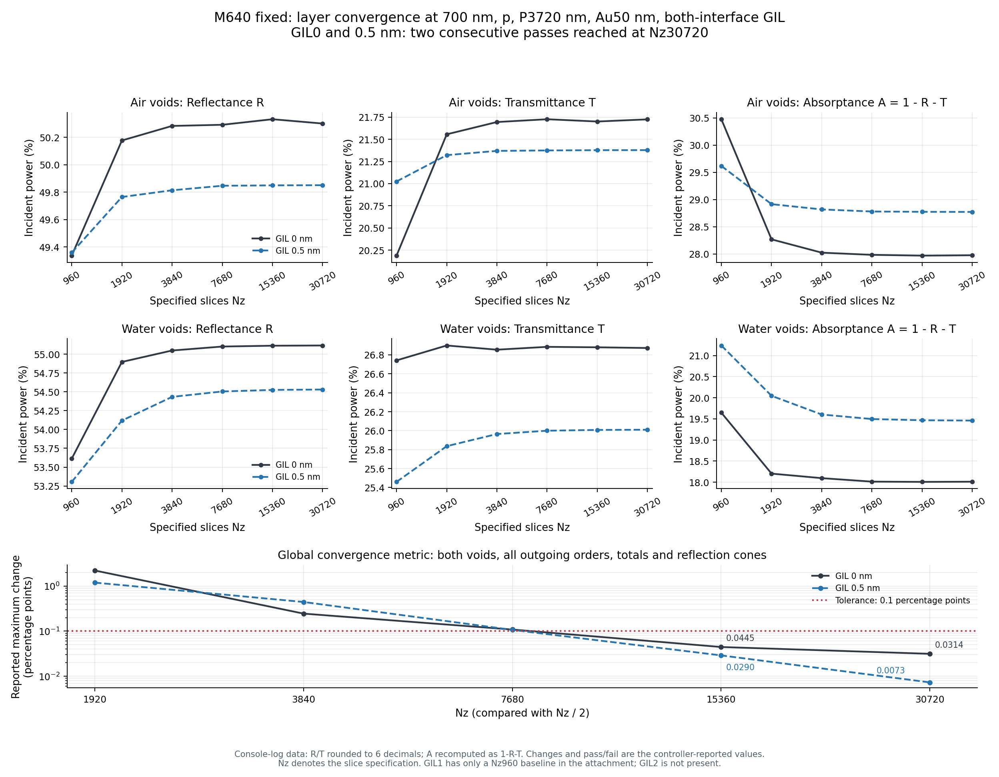
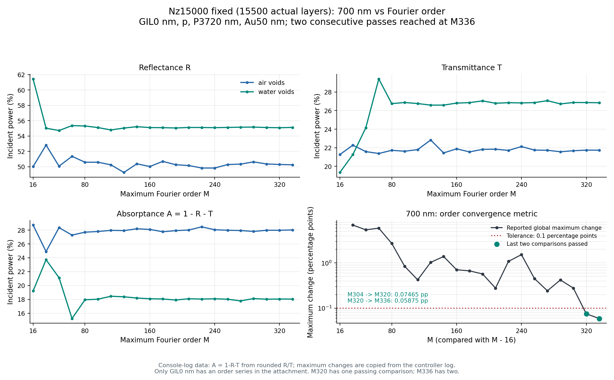

# 層数・次数の収束図（添付ログから作成）

周期3720 nm、700 nm、p偏光、Au公称50 nm。新たなRCWA計算は実行していません。

## M640固定の層数依存

GIL0・0.5 nmのNz960/1920/3840/7680/15360/30720、空気溝・水溝を表示。GIL1 nmはNz960の2点のみ、GIL2 nmはログにないため曲線を作成していません。

| GIL (nm) | Nz7680→15360 最大差(pp) | Nz15360→30720 最大差(pp) | ログの判定 |
|---:|---:|---:|---|
| 0 | 0.044523 | 0.031449 | 2回連続合格 |
| 0.5 | 0.029007 | 0.007314 | 2回連続合格 |

## Nz15000固定の次数依存

GIL0 nm、M16から336まで16刻み、空気溝・水溝。実層数は15500です。

M304→320は0.0746461 pp、M320→336は0.0587503 pp。M336で2回連続合格。M320は1回分の比較のみ合格です。

| M | 溝 | R (%) | T (%) | A=1-R-T (%) |
|---:|---|---:|---:|---:|
| 320 | air | 50.2848 | 21.7486 | 27.9666 |
| 320 | water | 55.0822 | 26.8640 | 18.0538 |
| 336 | air | 50.2451 | 21.7402 | 28.0147 |
| 336 | water | 55.1162 | 26.8427 | 18.0411 |

## 精度と解釈

R/Tはログ表示の小数6桁。Aは粗く丸められた表示値を使わず、1-R-Tで再計算しました。最大差と合否は元のコントローラが印字した値です。次数別CSVがないため最大差を独立に再計算したものではありません。

層数図の15360と、次数図の15000は別の設定です。層数の合格はM640固定、次数の合格はNz15000固定、いずれもログにある波長・条件だけに適用されます。真値誤差の上限や全波長の収束を保証しません。

CSVはログから抽出した全点と全比較を保存。PNGとSVGを用意しています。元のログ・RCWAコードは変更していません。ZIPは作成していません。
