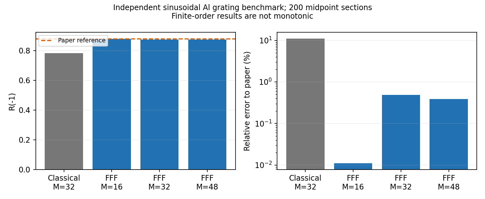
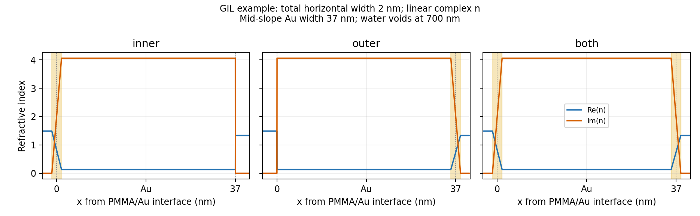
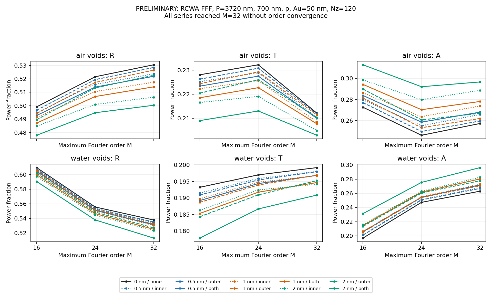
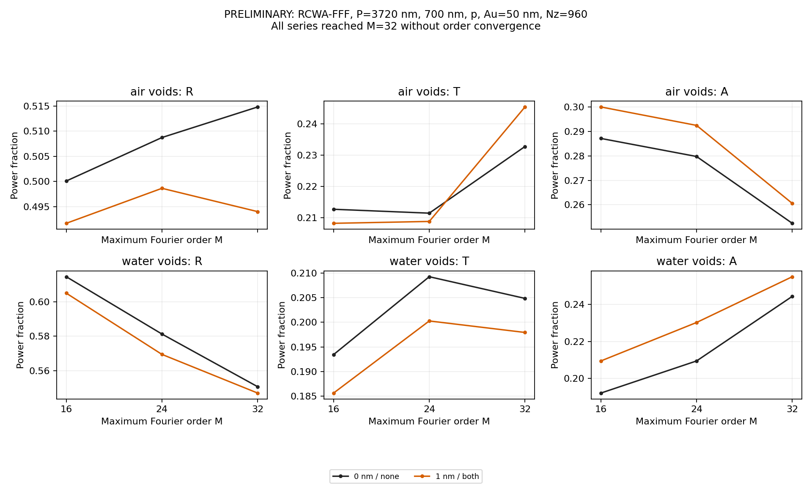

# RCWA-FFF検証結果（2026-11-15）

CPU：torch 2.8.0+cpu、complex128。GPUはこの環境にないためCUDAの実測検証は未実施です。GPUで再検査するコマンドは [実行説明](../../fff1d/README_ja.md) にあります。

## 従来法・対称性との一致

θ=90°、GIL=0、同じ中点層分割で、通常RCWAと比較しました。28形状/波長条件×s/p=56条件です。P3720/3920、Au0/50、空気/水、400/550/700 nm、追加の回折カットオフ近傍620 nm、M32/Nz120を含みます。位相平均比較は共通の1024 Sobol点を使います。生データは `cpu/validation.json` と `cpu/cases.json` です。

| 検査 | 最大絶対差 | 合格 |
|---|---:|---|
| theta=90, GIL=0 vs original even RCWA all amplitudes | 5.829e-14 | True |
| theta=90 all per-order R/T and R/T totals | 9.548e-15 | True |
| profile normals and GIL: even vs full Fourier response | 6.751e-15 | True |
| GIL DC epsilon integral vs exact linear-complex-index formula | 5.102e-17 | True |
| GIL DC inverse-epsilon integral vs exact formula | 3.606e-18 | True |
| GIL quadrature 16 vs 32: all coefficients through harmonic 128 | 7.883e-17 | True |
| uniform Au 50nm independent Airy amplitudes at all angles | 7.109e-16 | True |

角度の一致は有限M/Nzでの実装一致です。実際のAu構造での次数・層数収束の証明ではありません。通常RCWAの全ルートPythonのハッシュとソース署名は変更前と一致しています。

## 論文の独立Al格子との照合

論文図4/5の正弦波Al格子：周期500 nm、高さ200 nm、波長632.8 nm、入射40°、nAl=1.3+7.6i、p偏光。200中点断面、法線場のFFT格子4096点を使用し、本文のR−1参照値0.8785309971543と比較しました。今回の台形PMMA/Auとは別構造です。

| 方法 | M | R−1 | 参照値への相対誤差 |
|---|---:|---:|---:|
| lamellar | 32 | 0.781827798 | 11.007375% |
| rcwa-fff | 16 | 0.878433760 | 0.011068% |
| rcwa-fff | 32 | 0.874235267 | 0.488967% |
| rcwa-fff | 48 | 0.875102172 | 0.390291% |

M16が偶然小さい誤差となり、その後は単調ではありません。M16で収束したとは判定しません。論文の層入口評価と本照合の中点評価も区別してください。通常法側も全空間1階伝搬なので、この表の時間は既存の最適化ソルバーとの速度比較には使いません。

再計算：`python studies/pmma_sheet_relief_1d/validation/fff1d/paper_benchmark.py --device cpu --orders 16,32,48 --slices 200 --grid 4096`。`--device cuda:0` も指定可能です。

## GILの選択

下図は波長700 nm、水溝、斜面途中の横方向断面におけるδ=2 nmの例です。色付き範囲がGIL、0 nmと37 nmが鋭い界面の位置です。空気溝は外側の実屈折率が1になります。

## PMMA/Au構造の予備次数計算

P3720 nm、700 nm、p、Au50 nm、空気溝/水溝でM16/24/32を計算しました。Nz120ではδ=0/0.5/1/2 nmと3界面選択の全10条件、指定Nz960ではδ=0と1 nm両界面の2条件を試しました。すべて位相平均は収束し、パワーは受動性チェックを満たしましたが、**次数収束は全条件で不合格**です。

| Nz | δ (nm) | 界面 | 最終M | M24→32の最大差 | 状態 |
|---:|---:|---|---:|---:|---|
| 120 | 0 | none | 32 | 0.0200620 | 未収束・上限到達 |
| 120 | 0.5 | inner | 32 | 0.0189911 | 未収束・上限到達 |
| 120 | 0.5 | outer | 32 | 0.0196079 | 未収束・上限到達 |
| 120 | 0.5 | both | 32 | 0.0197591 | 未収束・上限到達 |
| 120 | 1 | inner | 32 | 0.0199349 | 未収束・上限到達 |
| 120 | 1 | outer | 32 | 0.0195594 | 未収束・上限到達 |
| 120 | 1 | both | 32 | 0.0215113 | 未収束・上限到達 |
| 120 | 2 | inner | 32 | 0.0213919 | 未収束・上限到達 |
| 120 | 2 | outer | 32 | 0.0216610 | 未収束・上限到達 |
| 120 | 2 | both | 32 | 0.0249957 | 未収束・上限到達 |
| 960 | 0 | none | 32 | 0.0348538 | 未収束・上限到達 |
| 960 | 1 | both | 32 | 0.0366040 | 未収束・上限到達 |

差はR_m/T_m、R/T/A、20°内外を含む全比較対象と空気/水の最大値です。許容差は0.001です。小次数の挙動だけから、GILの優劣や最終スペクトルは判断できません。δを変えると材料分布も変わるので、異なるδの差は打切り誤差ではありません。

全72点の集約値は `pilot_points.csv`、最終比較は `pilot_stopping_conditions.csv`、各次数の方向とR_m/T_mは各 `order_M/diffraction_orders.csv` にあります。Aは合計値です。出射次数別吸収という分解は行いません。保存済みの試運転フォルダは検証記録として参照し、本計算は新しい出力先で始めてください。

## 実行制御・既存結果

`test_automation.py` の25テストで、2比較連続合格、上限、刻みと合わない上限、上限延長、再開、非受動点の不合格、pのみ、停止/中断、OOM識別等を確認しています。OOMは模擬テストであり、実GPUのOOMは意図的に発生させていません。

再実行：`python studies/pmma_sheet_relief_1d/validation/fff1d/test_automation.py`。記録は `automation_tests.json`。通常RCWAの署名と元のルートPythonは `legacy_source_baseline.json`、今回の配布・既存結果保存検査は `installation_checks.json` を参照してください。

2026-08-06側へ反映後、Nz960の2点キャッシュが同じ署名で再利用されることを実測しました。別の小さい構造で4キャンペーンを実行し、GIL幅別上限9/10、刻みから外れる上限の実行、再開時に子計算を起動しないことも確認しました。これらは制御の検査であり物理収束の検査ではありません。元の444結果ファイル（87,355,158 bytes）は全SHA-256一致、通常RCWAのルートPythonも変更前と一致しています。
