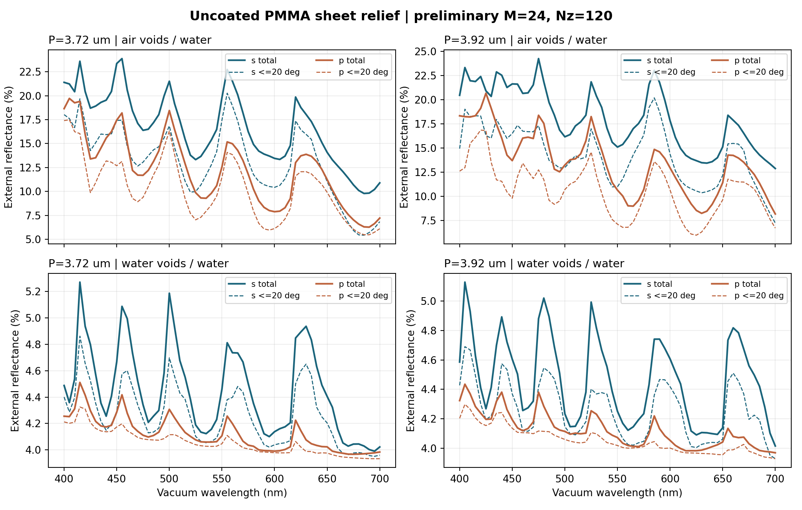
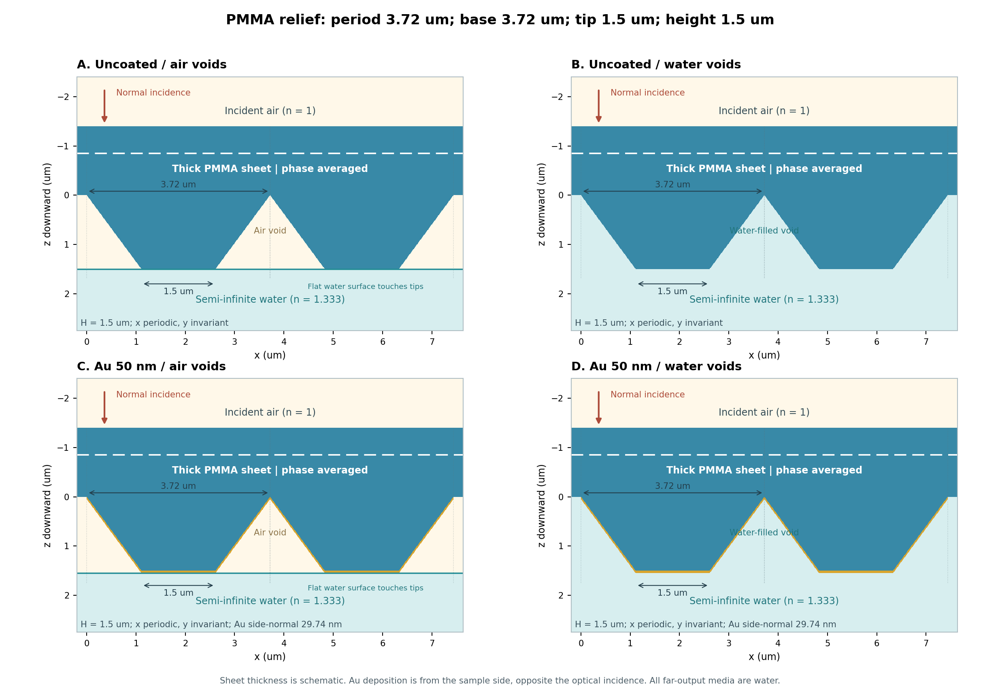
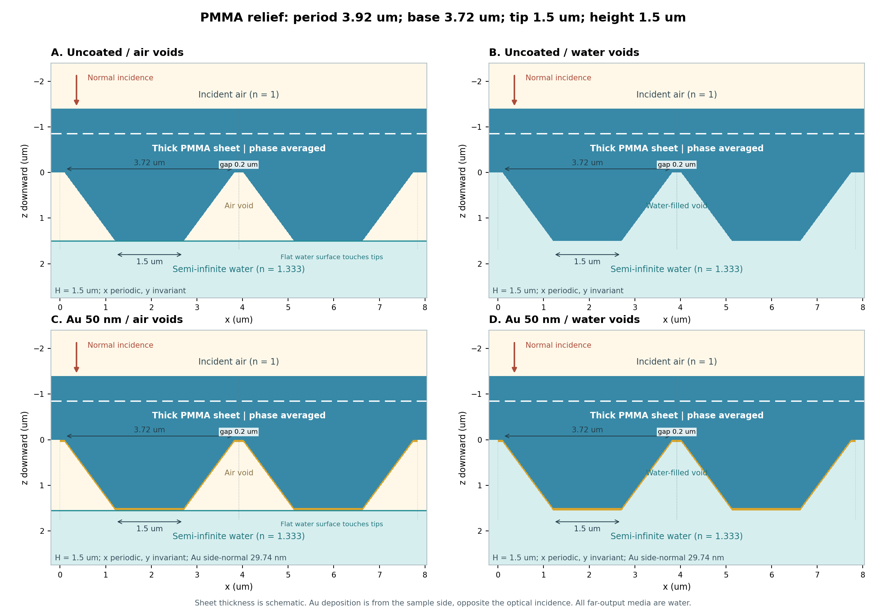

# PMMAシート下面の1次元構造：作成・試算結果

作成日：2026年11月13日

長辺3.72 µm、短辺1.5 µm、高さ1.5 µmを固定しました。周期3.72 µm（根元隙間0）と3.92 µm（根元隙間0.20 µm）を比較します。空気溝と水充填の両条件とも、その先は半無限水です。

## 作成した場所と内容

既存RCWA内の作成先：`C:\Users\tsoyu\Documents\Codex\2026-08-06\files-mentioned-by-the-user-extensions\outputs\studies\pmma_sheet_relief_1d`

この配布フォルダは同じstudyのコピーです。`uncoated/run_spectrum.py`、`gold/run_spectrum.py`、次数・層数収束用`converge.py`、物理検証`validate.py`、構造図`preview.py`を含みます。既存の共有solverを使用します。

- [実行手順・モデル・材料](README_ja.md)
- [数式の導出](THEORY_ja.md)
- [全スペクトルCSV](results/uncoated/spectra.csv)
- [次数別反射・透過・角度CSV](results/uncoated/diffraction_orders.csv)
- [回折方程式で許される次数と方向](results/kinematics/allowed_order_directions.csv)

## Auなし：実行した計算

400～700 nmを5 nm刻み（61波長）、2周期×空気溝/水充填×s/pの計488条件を計算しました。M=24（49調和成分）、Nz=120です。位相平均は2つのscrambleを使い、自動的にサンプル数を増やしました。

全488条件で位相平均の収束指標が2e-4以下でした（最大0.000199875）。吸収の最大絶対値は6.75e-13で、無損失のエネルギー保存を確認しています。

**この全スペクトルは初期試算です。M=24の全波長で次数・層数収束が完了したという意味ではありません。** 代表波長の精度確認は下に分けて記録します。

### 550 nmでの初期試算値（外部入射パワーに対する%）

| 周期µm | 溝内 | 偏光 | R合計 | R≤20° | R>20° | T合計 |
|---:|---|---|---:|---:|---:|---:|
|3.72|air|s|19.786|17.443|2.343|80.214|
|3.72|air|p|12.555|11.466|1.089|87.445|
|3.72|water|s|4.460|4.194|0.266|95.540|
|3.72|water|p|4.107|4.047|0.060|95.893|
|3.92|air|s|15.101|10.991|4.110|84.899|
|3.92|air|p|10.642|7.112|3.530|89.358|
|3.92|water|s|4.251|4.137|0.114|95.749|
|3.92|water|p|4.072|4.018|0.054|95.928|

空気溝条件では空気とPMMAのコントラスト、構造内の回折、先端面の空気/水境界が効きます。水充填条件と同じ構造寸法でも反射スペクトルが異なります。周期変更の優劣は波長と偏光に依存し、0.20 µm隙間が全域で反射を最小にするという結論ではありません。

## 代表波長での次数・層数収束

400/550/700 nm、両周期、両充填条件、s/pを対象に、全出射次数R_m/T_mとR/T/A、反射20°内外を比較しました。絶対許容差は1e-3（0.1パーセントポイント）。最後の連続2回の変化が許容差以下の場合に合格とします。

### フーリエ次数：合格（試験した条件の範囲）

比較値：16, 24, 32, 40, 48。Nz=120固定。

| 前→後 | 全次数・全集計の最大変化 | 判定 |
|---:|---:|---|
|16→24|0.00659526|未収束|
|24→32|0.0012071|未収束|
|32→40|0.000744201|合格|
|40→48|0.000510586|合格|

### 層数：合格（試験した条件の範囲）

比較値：60, 120, 240, 480。M=40固定。

| 前→後 | 全次数・全集計の最大変化 | 判定 |
|---:|---:|---|
|60→120|0.000660856|合格|
|120→240|0.000164103|合格|
|240→480|4.09569e-05|合格|

この確認は代表3波長・固定したもう一方の離散化条件に限ります。全帯域の最終データには、十分なMとNzを併用して全波長で再確認してください。共鳴付近の波長刻みの収束はまだ調べていません。

## Auあり：550 nmの動作確認

Au 50 nmモデルも両周期・両充填条件・s/pで550 nmのみ試算しました。M=24、Nz=120（実際の有限層数124）。全帯域AuスペクトルとAuモデルの離散化収束は今後実行する対象です。この表は動作確認で、Auの最終定量値ではありません。

| 周期µm | 溝内 | 偏光 | R (%) | T (%) | A (%) |
|---:|---|---|---:|---:|---:|
|3.72|air|s|50.250|10.353|39.396|
|3.72|air|p|26.325|16.197|57.479|
|3.72|water|s|47.895|13.839|38.266|
|3.72|water|p|27.877|37.928|34.195|
|3.92|air|s|50.195|9.993|39.812|
|3.92|air|p|28.365|12.283|59.351|
|3.92|water|s|44.211|19.338|36.451|
|3.92|water|p|28.099|35.542|36.359|

37.0 nmは斜面のx方向の厚さで、法線方向は29.742 nmです。水平の先端・谷底は50 nm。全体の吸収Aを算出し、各次数に`1-R_m-T_m`を割り当てる定義は使いません。

## 物理検証：全項目合格

| 検証 | 最大誤差 |
|---|---:|
|flat PMMA-water amplitude vs Fresnel|2.22e-16|
|phase average vs analytic incoherent planar sheet|9.38e-09|
|uniform Au 50nm amplitudes vs independent Airy formula|2.48e-16|
|full sheet phase samples conserve energy (s)|1.08e-14|
|+/- orders retain exact degeneracy (s)|2.83e-15|
|full sheet phase samples conserve energy (p)|1.3e-14|
|+/- orders retain exact degeneracy (p)|1.03e-14|
|lossless local grating all propagating incoming channels|6.16e-14|
|local scattering preserves mirror symmetry|5.58e-14|
|exact air cutoff 620nm: finite and zero grazing flux (s)|2.28e-12|
|exact air cutoff 620nm: finite and zero grazing flux (p)|6.36e-13|
|directional Au geometry side-normal thickness|0|

## 構造図

Auの蒸着は下側の試料側から行い、上側の光入射とは反対向きです。図のシート厚さのみ模式的で、微細構造の計算には記録した層断面を使用しています。

